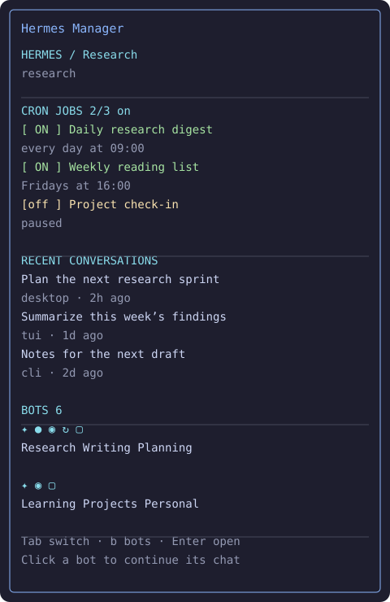

# Hermes Manager for Herdr

Manage local Hermes Agent profiles from ordinary Herdr workspaces: scheduled jobs,
recent conversations, and continuous Bot chats shared with Hermes Desktop.



*Illustration with example profiles and messages; no personal conversation data.*

## Features

- One `(H)` workspace per local Hermes profile, grouped after your project workspaces.
- A `──── HERMES ────` group separator using standard workspace metadata.
- A Manager pane in every profile tab: pause/resume cron jobs, edit schedules, inspect errors,
  and open recent conversations in new terminal tabs.
- A Bots grid inside Manager with Desktop icons, unread dots, and working indicators.
- Continuous Bot chat popups using the native Hermes backend and existing `Bot Chat` history.
- Streaming replies, thinking/activity updates when exposed by Hermes, manual tool approvals,
  mouse-wheel scrolling, drag-to-copy, and responsive closing.
- Optional shell integration: typing `hermes` inside a managed workspace selects its profile.

Uses standard Herdr plugin panes and APIs. No patched Herdr binary or custom build is required.

## Requirements and compatibility

- **macOS**, with **Python 3.9+**, **Node.js 22+**, npm, and Git available on PATH.
- **Herdr 0.9.3 or newer** with plugin, popup, workspace-metadata and layout APIs.
- An existing **Hermes Agent** installation with local profiles and `hermes` on PATH.
- Bots require the Hermes Desktop/`serve` backend interfaces: profile multiplexing,
  canonical `Bot Chat` sessions, session resume/events and shared read-state endpoints.

Verified on stock Herdr **0.9.3** and the locally installed Hermes checkout **b9df1cccae**.
The Hermes backend interfaces are not a versioned public SDK; other Hermes builds may need
adaptation. Cron and conversation management do not require Hermes Desktop to be open.
Bots reuse a running native backend or start `hermes -p default serve` on localhost.
No provider keys are bundled or needed by the plugin itself; Hermes manages its own credentials.

## Install

```sh
herdr plugin install skaftanis/herdr-hermes-manager --ref v0.3.0
herdr plugin action invoke hhl.hermes-manager.doctor
herdr plugin action invoke hhl.hermes-manager.setup
```

Herdr runs `npm ci --ignore-scripts --no-audit --no-fund` during installation. Review its
normal plugin trust preview before installing. Setup creates/adopts profile workspaces,
starts the roster helper, and adds marked blocks to Herdr's configuration and your zsh/bash
startup file. Original files are backed up under Herdr's `hermes-manager-backups` directory.

Open a new shell, or source the file printed by setup, to enable the `hermes` shell function.
Existing shells can source the same file without interrupting their processes. The function
runs only inside Herdr; outside it, `hermes` invokes your normal executable. Explicit
`-p` / `--profile` always takes precedence. Hermes's executable is never replaced.

The default focus shortcut is **Herdr prefix + h**, or prefix + alt+h if h is already used.
The plugin preserves existing custom Spaces row formats; add the divider token manually if
setup reports `divider_added: false` and you want it in an existing format. See [configuration](docs/configuration.md).

For Fish or another shell, run the installer with `--shell none` from the installed directory
and use explicit `hermes -p PROFILE` commands. Automatic shell routing supports zsh and bash.

## Controls

| Manager control | Action |
| --- | --- |
| Click a job toggle, or Space / x | Pause or resume the selected profile's cron job |
| e / d on a job | Edit schedule / inspect details |
| Click a conversation, or Enter | Resume it in a new tab |
| n | Start a fresh profile conversation in a new tab |
| Tab | Cycle jobs, conversations, and bots |
| b, arrows, Enter | Focus Bots, select a bot, open its chat |
| Click a bot | Open its continuous Bot Chat |
| Wheel / Page Up / Page Down | Scroll or page the selected section |
| r / a | Refresh / include background conversations |
| Esc / q | Leave details or return focus to an agent terminal |

| Chat popup control | Action |
| --- | --- |
| Enter / Ctrl+J | Send / insert newline |
| Wheel / Page Up / Page Down | Scroll chat history |
| Drag and release | Select visible conversation text and copy to the macOS clipboard |
| Ctrl+R | Reload native conversation history |
| Esc | Close, or decline the current pending question |
| Ctrl+D | Close immediately, including while a question is pending |

Closing a popup disconnects its frontend. It does not send a cancel command to the native
Hermes backend. Other Desktop/terminal clients and the backend determine session lifetime.
Available slash commands are forwarded to Hermes. `/new`, `/reset`, and `/clear` compact the
same Bot Chat; session-switching/deletion and canonical-title changes are blocked in this
popup to preserve its continuous identity. There is no slash-command autocomplete menu.

Approvals wait for an explicit approve-once/deny answer. Secret input is masked. Some
Desktop-specific capabilities must be handled in Hermes Desktop. Thinking text is shown
only when Hermes emits it; the plugin does not enable hidden reasoning or change model settings.

## Configuration

```sh
herdr plugin config-dir hhl.hermes-manager
```

Edit `config.json` there. See [all settings and the divider setup](docs/configuration.md).
After changing settings or updating code, invoke setup again and refresh only Manager panes:

```sh
herdr plugin action invoke hhl.hermes-manager.setup
```

From the plugin's installed/source directory, `python3 hermes_manager.py refresh` reloads
Manager panes without restarting agent terminals. Reinstall the desired Git tag to update
on Herdr versions without `plugin update`; newer Herdr versions also provide that command.
Run setup after an update so shell routing follows the new installed directory. We recommend
pinning release tags rather than following the default branch for daily use.

## Disable or remove

To pause management, use `herdr plugin disable hhl.hermes-manager`. Manager panes and the
roster helper stop at their next periodic check. Hermes profiles, chats, cron jobs and
workspace terminals remain. Re-enable and invoke setup to resume management.

For complete plugin removal:

```sh
herdr plugin action invoke hhl.hermes-manager.remove-setup
herdr plugin uninstall hhl.hermes-manager
```

The first command removes only marked shell/config blocks and disables the plugin. Your
other configuration edits and Hermes executable are preserved. Restart/source your shell
configuration to remove the loaded function; an already-loaded function falls back to the
ordinary executable after removal. Plugin config/state and backup files are retained by
Herdr. To remove setup with no server running, use `python3 uninstall.py --offline` from
its installed directory, then uninstall the plugin.

## Data and lifecycle

Profile discovery reads the fleet root (normally `~/.hermes`) and live profile directories.
Conversation history and unread metadata are read from profile-local SQLite databases in
read-only mode. Cron modifications use Hermes's CLI; Bot read-state changes use the native
session API. Opening a bot can materialize its native hidden `Bot Chat` and adopt Bot metadata,
but it never sends an introductory model prompt. Reading clears the shared Desktop unread badge.

Runtime files, private logs and the roster live under `HERDR_PLUGIN_STATE_DIR`; user settings
and shell setup live under `HERDR_PLUGIN_CONFIG_DIR`. No conversations, profiles, logs,
authentication tokens or local backups belong in this repository or release archive.
The helper polls every three seconds and exits when the plugin is disabled. A server started
by Hermes remains owned by Hermes and available to Desktop; uninstall does not stop it.

## Development

```sh
git clone https://github.com/skaftanis/herdr-hermes-manager.git
cd herdr-hermes-manager
npm ci --ignore-scripts
herdr plugin link "$PWD"
python3 install.py --activate
```

Checks (the automated suite sends no prompts to a real model):

```sh
python3 -m unittest discover -s tests -v
npm test
python3 scripts/bots_ui_check.py
python3 scripts/package_check.py  # requires a Git checkout with staged files
```

The UI check uses a disposable Herdr server/socket and recorded chat; it checks real Manager
clicks, popup history, wheel/page scrolling, drag selection, typing, and Escape. It requires
stock Herdr on PATH or `HERDR_TEST_BINARY=/path/to/herdr` and currently uses macOS PTY behavior.
An optional `python3 scripts/integration_check.py` additionally exercises real Hermes cron
commands with isolated temporary profiles. It requires the source/runtime layout described
inside that script and never executes cron jobs. Set `HERMES_TEST_BINARY` to the original
Hermes executable if your normal launcher depends on local shell/custom restore configuration. See [release notes](CHANGELOG.md).

MIT licensed. This is an independent community plugin, not an official Herdr or Hermes product.
